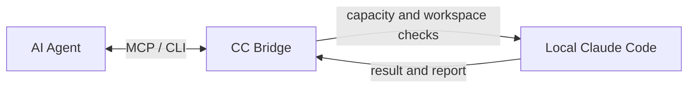

# CC Bridge

[English](README.md) | [简体中文](README.zh-CN.md)

A local, durable and governed bridge that lets AI agents delegate coding tasks to Claude Code through MCP or CLI.

Give an agent a project directory and a task. CC Bridge checks the available
Claude subscription capacity, starts your local Claude Code, and keeps its
progress, result and report on disk. When capacity is low, work can wait for
the actual reset and continue under your saved policy.

**Requires a working Claude Code CLI (`claude --version`) and Python 3.10+.**
Having a desktop application installed does not by itself prove that the CLI
is available. CC Bridge orchestrates the local CLI; it is not a model API client.

**v1.1.2 · MIT · Local first · MCP + CLI · Windows offline tests**



## What you get

- Durable tasks: inspect progress and full results after the calling agent disconnects.
- Five-hour **and** weekly usage checks before starting or resuming work, with a bounded cache to avoid repeated requests.
- Configurable capacity reserves: defaults stop automatic starts at **90% five-hour** or **95% weekly** utilization.
- Persistent waiting and optional automatic continuation after a verified reset.
- Completion events that another local agent can claim and acknowledge.
- One canonical report per attempt, checked against a task/attempt/hash receipt.
- A kernel-backed single-task lock and explicit trusted roots for write work.
- The same interface for Codex and other MCP clients, or agents that can run local commands.

## Install and connect

First install and authenticate [Claude Code](https://code.claude.com/docs/en/setup),
then confirm `claude --version` works. Your existing provider/proxy configuration
is inherited. Usage monitoring currently needs a file-based Claude subscription
login; keychain-only or API-provider accounts may return `AUTH_STALE`/`UNKNOWN`.

```powershell
git clone https://github.com/AlexLI1935/cc-bridge.git
cd cc-bridge
python -m venv .venv
.\.venv\Scripts\python.exe -m pip install -r requirements-mcp.txt
.\.venv\Scripts\python.exe cc_bridge.py config show
```

Register the server in your MCP client, replacing both placeholders with absolute
paths. Windows JSON paths can use forward slashes. Configuration locations vary
by client; [examples/mcp.json](examples/mcp.json) is a template.

```json
{
  "mcpServers": {
    "cc-bridge": {
      "command": "<absolute-path-to-venv-python>",
      "args": ["<absolute-path-to-checkout>/mcp_server.py"]
    }
  }
}
```

Running `python mcp_server.py` by hand starts a stdio service waiting for a client,
so a quiet terminal is normal. The core CLI uses the Python standard library.

## First-run permissions

Usage inspection is **opt-in**. Ask the user before recording this permission:

> Allow CC Bridge to read the local Claude Code authentication credential only
> for retrieving Claude subscription usage information.

After the user agrees, run the following with the bridge's Python interpreter:

```powershell
python cc_bridge.py usage-authorize --yes
python cc_bridge.py usage-refresh
```

Without `--yes`, an interactive terminal asks for confirmation. Agents must obtain
the user's consent before passing this flag. No MCP tool grants consent. Revoke
it with `python cc_bridge.py usage-revoke`.

The authorization record contains no token. CC Bridge reads the local Claude
login only after approval, holds the access credential in process memory and
sends it only to the fixed Anthropic HTTPS usage endpoint. Redirects are refused.
It never copies credentials into configuration, cache, logs, reports or MCP output.

Usage requests are spaced out: **at least five minutes apart**, with a default of
five minutes. Starting, checking and resuming a short task share the same valid
cached reading rather than sending a burst of requests. The cache expires after
five minutes and cannot verify a reset that occurred after it was fetched.
If it is stale, work waits for the next permitted successful refresh. Failed queries
also count toward the interval; a longer server `Retry-After` takes precedence.
The cooldown persists across restarts. Keep one `CC_BRIDGE_HOME` for the same account.
`get_cc_usage` reads cache, and ordinary task-status polling sends no usage request.
Upgrading the old default policy migrates its six-minute/420-second settings to
five minutes/300 seconds. Consent, workspace approvals and usage ceilings are preserved.

This integration uses the locally authenticated subscription session and **is not
a documented stable public API contract**. Endpoint changes return unknown/stale
usage, never invented capacity. Historical values remain visibly stale, with
`last_valid_at`; automatic work does not start from them.

## Start a task

With MCP, call `submit_cc_task` with a goal, an existing absolute `workdir`, and a
prompt. It starts a background runner or returns `WAITING_USAGE_RESET` under the
saved policy. Keep the returned ID and poll `get_cc_task`; `full=true` includes
the final text, report validation and logs.

```json
{
  "goal": "Review this project",
  "workdir": "<absolute-project-directory>",
  "prompt": "Find one concrete correctness issue. Explain its trigger and affected file. Do not modify files.",
  "mode": "read_only"
}
```

Or use PowerShell from the checkout:

```powershell
$project = (Get-Location).Path
$created = python cc_bridge.py new --goal "Review this project" --workdir $project --prompt-file examples/review.md | ConvertFrom-Json
$taskId = $created.task_id
python cc_bridge.py submit $taskId
python cc_bridge.py status $taskId
python cc_bridge.py result $taskId
python cc_bridge.py list --limit 10
```

`new` only saves a task. `submit` starts it in the background; `run $taskId` is the
foreground alternative for a new task. No extra runner command is required for MCP.

For changes, explicitly approve the project root first, then create a task with
`--mode write` or MCP `mode="write"`:

```powershell
python cc_bridge.py trust-workspace $project --yes
python cc_bridge.py resume $taskId --prompt "Investigate the issue further."
python cc_bridge.py cancel $taskId
python cc_bridge.py revoke-workspace $project
```

Trust covers the selected directory and its descendants after resolving paths.
Resume keeps the saved permission mode and exact session UUID. A task blocked
before its first Claude launch can start later without a prior UUID. Interrupted
work with no usable saved session is not silently replayed. Cancellation also
cancels a waiting task; it does not undo edits already made.

## Your resource policy

On first runtime startup, CC Bridge creates **`CC_BRIDGE_HOME/config.json`**.
This is the authoritative, validated configuration, independent of the checkout.
[config.example.json](config.example.json) shows the full schema.

| Setting | Default | Meaning |
| --- | --- | --- |
| `usage.five_hour.max_utilization_pct` | `90` | Stop automatic starts at 90%, aiming to leave 10% for manual work |
| `usage.weekly.max_utilization_pct` | `95` | Leave about 5% weekly capacity for emergencies |
| Each window's `auto_wait_for_reset` | `true` | Persist a wait and arrange a later verification |
| Each window's `auto_resume_after_reset` | `true` | Continue intended work after every gate passes again |
| `usage.refresh_interval_minutes` | `5` | Shared minimum request interval and running refresh period; must be at least 5 minutes |
| `usage.fresh_seconds` | `300` | Reuse a valid reading only while younger than this limit; cannot exceed 300 seconds |
| `usage.reset_grace_seconds` | `60` | Wait this long after the actual reset before checking again |
| `timezone.mode` | `system` | Detect the operating system's timezone on startup and refresh |
| `reset_scheduler.backend` | `system` | Windows Task Scheduler, with persisted caller-polling fallback |

Both windows must pass: utilization must be **strictly less than** its ceiling.
When both block, the next candidate is the later returned reset instant, plus
the grace period. CC Bridge never substitutes “now + five hours”.

At that time, it refreshes both windows again. If still blocked, it saves the new
response and waits again. Unknown/authentication/error states cannot start work.
Cycle IDs, transactional dispatch and the kernel lock prevent duplicate resume.
Running tasks are stopped for a later continuation if a periodic check finds a
ceiling reached. Provider reporting delays and work between checks can overshoot
a reserve; these are governance limits, not a guaranteed real-time billing cap.

Windows wakeups use a single named scheduled task per runtime home, an absolute
reset instant, and `StartWhenAvailable` for missed checks after a restart. A refused
registration is reported as `caller_polling`: keep polling `get_cc_pending` or run
`python cc_bridge.py scheduler-tick`. Linux/macOS use that same persisted fallback.
They do not autonomously wake without a caller or an externally configured scheduler.
Disable automatic continuation in **both** window policies if you want manual resume.

```powershell
python cc_bridge.py config show
python cc_bridge.py config validate
python cc_bridge.py config set usage.five_hour.max_utilization_pct 85
python cc_bridge.py config set usage.weekly.auto_resume_after_reset false
```

You may edit `config.json` directly; malformed values fail closed. Values must be
finite, thresholds must lie in 0..100, and `system` and `explicit` timezone modes are supported.
`usage.enabled=false` disables automatic task execution as well as credential
inspection; it is **not** a quota-check bypass. Authorization and trusted roots have
dedicated approval/revocation commands.

The original CLI refresh idea is retained behind
`usage.allow_cli_refresh_probe=false`: normal stale-auth handling first tries the
non-generative `claude auth status`, then rereads the credential. Status may not
refresh every login. The separately enabled minimal model probe can use quota;
otherwise unresolved authentication returns `AUTH_STALE`. No custom OAuth flow is used.

## Time, results and notifications

Time comes from the OS clock, OS timezone rules and the service's absolute reset
timestamp. Model messages, language and IP location play no part. UTC/epoch is
the scheduling truth; local reset text is for display. Conversion uses the rules
at the **future reset instant**, including daylight saving changes. Startup and
refresh update the detected timezone and pending local displays. Large clock
differences from the HTTPS response Date produce `CLOCK_SKEW` and block scheduling.

Read the final task status and check `report_validated`. Each attempt has one
canonical `report.md` and a receipt binding its hash to the task and attempt.
This proves that the returned report exists and matches; it does not prove that
the model's proposed code is correct. Inspect files and run appropriate checks.

Events persist under `runtime/pending`. Use `get_cc_pending`, claim an exact
`event_id` with `claim_cc_pending`, process the result, then call `done_cc_pending`.
`first_claim` is true once; clients must handle interrupted claims deliberately.
Events include `TASK_COMPLETED`, `TASK_FAILED`, `TASK_NEEDS_INPUT`,
`TASK_WAITING_USAGE_RESET`, `USAGE_AVAILABLE`, `TASK_RESUMED` and `TASK_CANCELLED`.

Optionally set `CC_BRIDGE_WAKE_COMMAND` to a JSON argv array, such as
`["my-local-notifier","--event"]`. The bridge appends event and task IDs, invokes
it without a shell, and discards its output. Hooks are best effort; the durable
outbox is the source of truth. No messaging service is built in.

## Interfaces and storage

The original five MCP tools keep their names and arguments: `submit_cc_task`,
`get_cc_task`, `resume_cc_task`, `cancel_cc_task`, `list_cc_tasks`. Added tools are
`get_cc_usage`, `refresh_cc_usage`, `get_cc_pending`, `claim_cc_pending`,
`done_cc_pending`. Cached usage never performs a refresh.

Additional CLI commands: `usage`, `usage-refresh`, `usage-authorize`, `usage-revoke`,
`config show|validate|set`, `environment`, `trust-workspace`, `revoke-workspace`,
`pending`, `pending-claim`, `pending-done`, `schedule-reset-reminder`,
`usage-reset-notify`, `scheduler-tick`. Run `--help` for task options, including
model/effort overrides and execution deadlines.

`status`/`result` returning `success=true` means the read succeeded; inspect
`status` (`COMPLETED`, `FAILED`, `NEEDS_INPUT`, `WAITING_USAGE_RESET`, etc.) separately.
CLI exit codes: 0 accepted operation, 1 unsuccessful foreground result, 2 operation error.

| Environment | Purpose |
| --- | --- |
| `CC_BRIDGE_HOME` | Windows defaults to `%LOCALAPPDATA%/cc-bridge`; otherwise `~/.cc-bridge` |
| `CC_BRIDGE_CLAUDE_PATH` | Fallback executable path when `claude` is absent from PATH |
| `CLAUDE_CONFIG_DIR` | Claude's optional existing configuration directory for file-based authentication |

Tasks live in `tasks/`, results and per-attempt logs in `results/`, cache/events/locks
in `runtime/`, all under the runtime home. No runtime data belongs in Git. `.env`
is not loaded automatically. Keep runtime storage on a private local disk.

## Permissions and limitations

- `read_only` exposes Read/Glob/Grep in plan mode; it cannot execute tests.
- `write` uses dontAsk and file/Bash tools, requires a trusted workspace, and
  retains Claude permission checks. No permission bypass is provided. Child MCP
  servers, hooks and slash commands are disabled. This is not an OS sandbox.
- Subscription credentials are presently read from Claude's file-based store.
  Keychain-only and non-subscription providers may be unavailable to monitoring.
  Endpoint compatibility can change; unknown usage blocks automatic execution.
- Windows subprocess/MCP behavior and scheduler XML are tested with mocks/fakes.
  Live model execution, real-account usage and actual OS wakeups are not part of
  the offline suite. Linux/macOS remain not officially verified.
- Force-killing a runner may leave children; inspect failed tasks before continuing.
  `cleanup_required=true` blocks more work until the process tree is manually
  stopped and that flag is cleared in the latest result.
- MCP is a trusted local stdio interface, without network authentication. Keep
  task prompts/results private and do not expose the server as a network service.

## Development and agent setup

```powershell
.\.venv\Scripts\python.exe -m pip install -r requirements-dev.txt
.\.venv\Scripts\python.exe -m pytest -q
```

Tests use fake Claude executables and mocked account responses; no paid model or
real account is contacted. [SKILL.md](SKILL.md) is the agent deployment/operation
contract. [Capability comparison](CAPABILITIES.md) records what was retained and restored.

v1.0 callers keep their MCP configuration and tool signatures. **Behavior is stricter**:
usage consent, fresh valid capacity and write-workspace approval are now required.
Existing tasks remain readable; no existing production installation is upgraded automatically.

## License and author

[MIT](LICENSE), copyright (c) 2026 Alex Li.


## Headless coding and compatibility

Approving a workspace lets write tasks read, edit and run ordinary development
commands without a person approving each command. Write mode uses `dontAsk` with
`--allowedTools Read Glob Grep Edit Write NotebookEdit Bash`, and omits `--tools`.
Anything requiring approval outside those grants is denied. There is no automatic
bypass mode. Deployment, remote pushes and system changes remain outside the task
contract. Broad Bash authorization is not an OS sandbox or a directory confinement
guarantee; only trust projects and instructions you intend to execute.

Read-only retains the Read/Glob/Grep tool set and cannot execute Bash or edit.
Managed/user deny rules still take precedence; report denials rather than changing
global permissions. `environment` reports the actual installed Claude CLI version.
Windows CLI 2.1.286 was tested: Bash remained visible in a clean `--tools` comparison,
so the reported disappearance was not reproduced as a universal version defect.
Write avoids that option for compatibility. `acceptEdits` without Bash grants did
not provide the required unattended command contract. No fragile exact-version block
is imposed. See [permissions](https://code.claude.com/docs/en/permissions) and
[CLI reference](https://code.claude.com/docs/en/cli-reference).

## Time baseline: absolute scheduling, observed local display

On the first real task dispatch in each Bridge process, an unauthenticated HTTPS
HEAD request obtains a trusted external UTC Date. The bridge reads local wall time
and records their difference as `observed_utc_offset_minutes` in
`runtime/time-baseline.json`. This is not a subscription usage query. Subsequent
tasks in that process reuse the baseline. Restart, detected OS timezone/offset
change, a clock discontinuity or `config set timezone.refresh_observed_offset true`
causes a new observation. A failed probe is UNVERIFIED and falls back to OS/UTC
display; it does not invent an offset or grant permission to start tasks.

Reset, WAITING, cache age, cooldown and one-shot wakeups retain absolute UTC/epoch
truth. “In five hours” means `now_epoch + 18000`; running timeouts use a monotonic
clock. Automatic local display uses the observed current offset. A wrong OS label
alone does not block quota recovery. Actual system UTC skew against trustworthy UTC
still reports CLOCK_SKEW: an inaccurate absolute clock cannot safely drive epoch
scheduling. Neither probe nor diagnostics guesses geography or changes the OS.

IANA identity is optional for local recurrences and DST, not a reset prerequisite.
Explicit `timezone.name` plus `timezone.mode=explicit` can select IANA display rules;
default `system` display uses the observed offset when available. Install tzdata
for IANA rules (included in MCP dependencies). Daily 09:00 rules retain timezone,
local hour/minute and recurrence, then resolve each occurrence anew using
`cc_time.next_local_occurrence`; nonexistent times are skipped and repeated times
use the first fold once. This helper does not add a recurring execution service.
An observed offset describes the current wall clock, not future DST rules.

Created and maintained by [Alex Li](https://github.com/AlexLI1935).
