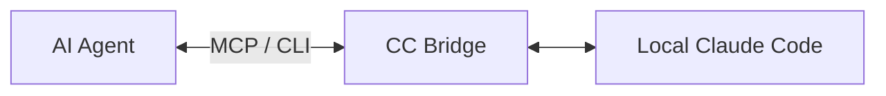

# CC Bridge

[English](README.md) | [简体中文](README.zh-CN.md)

A lightweight local bridge that lets AI agents delegate coding tasks to Claude Code through MCP or CLI.

CC Bridge gives an AI Agent a small, persistent task interface: start work, inspect
status, read output, resume a session, or cancel it. Use it with Codex, another MCP
client, or any Coding Agent that can invoke a local Python command.

**v1.0.0 · MIT · Python 3.10+ · Windows tested with a fake Claude executable**



## Installation

Install and configure the [Claude Code CLI](https://code.claude.com/docs/en/setup)
first. Confirm `claude --version` works and authenticate through Claude Code.
CC Bridge uses that installation and its existing provider configuration.

```powershell
git clone https://github.com/AlexLI1935/cc-bridge.git
cd cc-bridge
python -m venv .venv
.\.venv\Scripts\python.exe -m pip install -r requirements-mcp.txt
.\.venv\Scripts\python.exe mcp_server.py
```

The last command starts a **stdio MCP server** and waits for a client; it does
not open a web page. Usually your MCP client launches it using the configuration
below. The core CLI needs only the Python standard library.

## Why CC Bridge?

Agent Delegation to a local CLI needs durable task IDs and observable outcomes.
CC Bridge stores plain JSON task contracts, results, and per-attempt logs, so
the calling agent can disconnect and inspect work later. There is no cloud
service, database, routing framework, or account system to operate.

## Features

- Create tasks and run Claude Code in the foreground or background.
- Query state and complete JSON/text results through CLI or MCP (Model Context Protocol).
- Resume the exact saved Claude session UUID; cancel queued or running tasks.
- Default to restricted file inspection; explicitly select write mode for AI Coding work.
- Enforce one active task per runtime directory with OS-backed locks and atomic state writes.
- Preserve separate logs and reports for each attempt, with UTC timestamps.

## Quick start

### MCP

Add a server entry to your client's MCP configuration. Replace both placeholders
with absolute paths; on Windows, escape backslashes in JSON or use forward slashes.
The client-specific configuration location varies. A template is in
[`examples/mcp.json`](examples/mcp.json).

```json
{
  "mcpServers": {
    "cc-bridge": {
      "command": "<absolute-path-to-venv-python>",
      "args": ["<absolute-path-to-checkout>/mcp_server.py"]
    }
  }
}
```

The server exposes exactly five tools:

| Tool | Purpose |
| --- | --- |
| `submit_cc_task` | Create a task and launch its runner immediately |
| `get_cc_task` | Read state; `full=true` includes output, Claude JSON, and log paths |
| `resume_cc_task` | Start another attempt with the saved session UUID and a continuation prompt |
| `cancel_cc_task` | Cancel queued work or request running process termination |
| `list_cc_tasks` | List recent tasks, with a configurable limit |

Example tool arguments (replace the workdir with an existing absolute directory):

```json
{
  "goal": "Review the repository",
  "workdir": "<absolute-project-directory>",
  "prompt": "Find one concrete correctness issue. Cite the affected file and trigger. Do not modify files.",
  "mode": "read_only"
}
```

Save the returned `task_id`, poll `get_cc_task`, then read the full result.
Submission and resume return immediately; no second runner command is needed.
If submission fails after creation, the error includes the created task ID so
you can inspect it, submit it later through the CLI, or cancel it.

### CLI

Run these PowerShell commands from the checkout. The sample reviews the checkout
itself; change `$project` to another repository's absolute path as needed.

```powershell
$project = (Get-Location).Path
$created = python .\cc_bridge.py new --goal "Review the repository" --workdir $project --prompt-file .\examples\review.md | ConvertFrom-Json
$taskId = $created.task_id
python .\cc_bridge.py submit $taskId
python .\cc_bridge.py status $taskId
python .\cc_bridge.py result $taskId
python .\cc_bridge.py list --limit 10
```

For intended continuation of an ended session:

```powershell
python .\cc_bridge.py resume $taskId --prompt "Investigate the issue in more detail."
python .\cc_bridge.py status $taskId
```

To stop queued or running work:

```powershell
python .\cc_bridge.py cancel $taskId
python .\cc_bridge.py status $taskId
```

For foreground execution, use `run $taskId` in place of `submit` on a newly
created task. `new --prior-session-id <uuid>` can explicitly start from an
existing Claude session. `--mode write` enables repository changes.
`--complexity normal|complex|hard` defaults to sonnet/medium, opus/medium, and
opus/high respectively; `--model` and `--effort low|medium|high` override those choices.
No choice depends on account usage. Use `new --max-runtime-minutes 30` to set a
deadline (default 120, maximum 480 minutes).

CLI commands return one JSON object. Exit codes: `0` successful operation,
`1` foreground task did not complete successfully, `2` validation/operation error.
`status`/`result` returning `success=true` means the read succeeded; always check
`status` to determine the task outcome. `--help` and `--version` print plain text.

## How it works and task lifecycle

`new` writes a task and an initial `QUEUED` result. `submit` reserves the single
execution slot and starts a detached Python runner, which invokes Claude with
the prompt on stdin and JSON output redirected to attempt logs. A queued task
is not automatically scheduled: submitting while another task is active returns
an error. Separate CLI and MCP processes share state when `CC_BRIDGE_HOME` agrees.

```text
QUEUED -> RUNNING -> COMPLETED | FAILED | NEEDS_INPUT | WAITING_USAGE_RESET
QUEUED -> CANCELLED
RUNNING -> CANCELLING -> CANCELLED
ended task + saved session UUID -> explicit resume -> QUEUED -> RUNNING
```

Resume retains the permission mode and uses `--resume <exact UUID>`, never an
implicit "continue latest" session. It creates a new attempt without overwriting
older logs. A task with no saved UUID cannot resume. Cancellation is cooperative:
the runner stops its Claude process tree, then records `CANCELLED`; poll through
`CANCELLING` before starting replacement work. Cancellation does not undo edits.
An unexpectedly exited runner is recorded as failed when state is next read.

## Permissions

| Mode | Claude configuration | Intended use |
| --- | --- | --- |
| `read_only` (default) | `plan`, tools limited to `Read,Glob,Grep` | Review and investigation; no shell execution or tests |
| `write` | `acceptEdits`, file tools and `Bash` | Authorized repository edits; shell commands remain permission-controlled |

CC Bridge never enables permission bypass. Both modes disable inherited MCP
servers, hooks, and slash commands for the child session. Local/managed Claude
permission policies still apply. A denied tool or a response beginning with
`NEEDS_INPUT` produces `NEEDS_INPUT`; resolve the missing permission or decision
before explicitly resuming. Headless execution cannot interactively approve a prompt.

These controls use [Claude Code's CLI flags](https://code.claude.com/docs/en/cli-reference)
and [permission modes](https://code.claude.com/docs/en/permissions). They are not
an OS sandbox. Claude can access data permitted by the local account and its
configuration. Run only trusted projects; use an isolated account or environment
when stronger filesystem or network isolation is required. The prompt instructs
Claude to stay within the workdir and avoid deployments; this instruction alone
is not a security boundary.

## Configuration

| Variable | Default and behavior |
| --- | --- |
| `CC_BRIDGE_HOME` | Windows: `%LOCALAPPDATA%/cc-bridge`; otherwise `~/.cc-bridge`. Created automatically on first operation. |
| `CC_BRIDGE_CLAUDE_PATH` | Fallback executable path if `shutil.which("claude")` finds nothing on PATH. |

For example, to isolate this checkout's data on Windows:

```powershell
$env:CC_BRIDGE_HOME = Join-Path $env:LOCALAPPDATA 'cc-bridge'
```

Use shell environment variables or your MCP client's server `env` object.
[`.env.example`](.env.example) is a reference; `.env` is not loaded automatically.
Normal provider and proxy environment variables are inherited by Claude.
CC Bridge never opens Claude OAuth login files or queries account usage endpoints.
Usage-limit detection only examines Claude's response; the bridge does not know
reset times, schedule reminders, or resume automatically.

Runtime layout:

```text
CC_BRIDGE_HOME/
  tasks/<task_id>/task.json
  results/<task_id>/result.json
  results/<task_id>/runner.log
  results/<task_id>/attempt-N/{stdout.log,stderr.log,result.json,report.md}
  runtime/{state.lock,runner.lock}
```

Lock files persist by design; kernel locks release when processes close them.
Do not delete lock files to force concurrency. Keep runtime data on a local disk.

## Use with AI agents

[`SKILL.md`](SKILL.md) is the English integration guide for agents. It describes
the exact MCP tools, CLI fallback, permission choices, and result verification.
Register the server in an MCP-capable agent or invoke Python from a local tool.
The bridge has no dependency on a particular calling agent.

## Project structure and development

```text
cc_bridge.py           Core task execution and CLI (standard library)
mcp_server.py          Thin stdio MCP wrapper
SKILL.md              Agent integration instructions
examples/             Review prompt and MCP configuration template
tests/                Offline tests with a generated fake Claude executable
```

```powershell
.\.venv\Scripts\python.exe -m pip install -r requirements-dev.txt
.\.venv\Scripts\python.exe -m pytest -q
```

Tests exercise subprocess execution, persistence, concurrency, resume, cancellation,
timeouts, CLI errors, and a real MCP stdio handshake/tool call. They never contact
Claude or use paid model calls. On Windows the test fixture uses the launcher
bundled with pip to create its fake executable. GitHub Actions runs the suite on Windows.

## Security and limitations

- The MCP server is a trusted **local stdio** interface with no remote authentication.
  Anyone able to invoke it can request write tasks; do not expose it as a network service.
- Task prompts, source excerpts, results, and logs may contain sensitive data.
  Keep runtime storage private and outside the public checkout. Retention is manual.
- Claude Code is a separate dependency under its own terms. A usable local login
  or provider is required, and normal Claude usage charges/limits apply.
- Windows native execution and MCP were tested using a fake executable. Real
  Claude model execution was deliberately excluded from offline release tests.
  Linux/macOS paths are implemented but not yet officially tested.
- Use a recent CLI supporting the documented flags. No automatic CLI downgrade,
  retry, scheduler, notification channel, or account usage monitor is included.
- Force-killing the runner or shutting down the machine can interrupt work.
  Inspect logs and any surviving child processes before resuming a failed attempt.
- If process termination is refused by the OS, the result is `FAILED` with
  `stage=cleanup` and `cleanup_required=true`; further execution is blocked.
  Stop the recorded process tree manually, verify it is gone, then clear that
  flag in the task's latest `result.json`. Never clear it while work is still running.

## License

[MIT](LICENSE), copyright (c) 2026 Alex Li. No third-party source code is bundled;
the MCP SDK and test dependencies retain their respective licenses.

## Author

Created and maintained by [Alex Li](https://github.com/AlexLI1935).
