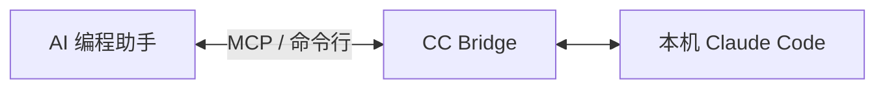

# CC Bridge

[English](README.md) | 简体中文

**让 AI 编程助手把任务交给你电脑上的 Claude Code，做完以后再把结果接回来。**

CC Bridge 是一个轻量的本地桥接工具。你可以用它把 Codex 或其他 AI Agent 和 Claude Code 接起来：提交任务、后台执行、查看进度、读取结果，也能接着已有会话继续做，或者中途叫停。

支持 MCP 和命令行两种接入方式。MCP（Model Context Protocol，模型上下文协议）可以理解成 AI 工具之间的一种通用接口；如果你的 Agent 能调用本地 Python 命令，也可以直接使用命令行。

**v1.0.0 · MIT 开源 · Python 3.10+ · 已在 Windows 上使用模拟 Claude 程序测试**



## 它解决什么问题？

如果你正在用一个 AI 编程助手，同时想让 Claude Code 帮忙检查代码、调查问题或完成一项修改，就需要把任务传过去，并且知道它什么时候做完、结果在哪里。

CC Bridge 把这个过程接了起来。每个任务都有自己的 ID，任务说明、执行状态、结果和日志都保存在本地。上层 Agent 可以提交后再回来查询，不需要一直占着前台等。

比如，在接好 CC Bridge 以后，你可以让 AI Agent：

> 把这个项目交给 Claude Code 看一下，找一个有明确依据的问题，先不要改文件。

需要实现功能或修复问题时，也可以明确选择写入模式。任务结束后，上层 Agent 仍应检查代码改动和交付结果。

任务说明由上层 Agent 整理，CC Bridge 不会自动同步两个助手的全部聊天记录。它没有额外的云服务、数据库或账户系统，直接调用你本机安装的 Claude Code。

## 主要功能

- **创建和执行任务**：前台运行，或者提交后在后台运行。
- **查询进度和结果**：通过 CLI 或 MCP 读取任务状态、完整输出和日志路径。
- **继续已有会话**：使用明确保存的 Claude 会话 UUID 续跑。
- **取消任务**：取消尚未启动的任务，或者请求停止正在执行的 Claude 进程树。
- **区分只读和写入**：默认只读，需要修改项目时明确选择写入模式。
- **保护本地状态**：原子写入状态文件，并用操作系统文件锁限制同一运行目录内只能有一个活跃任务。
- **保留执行记录**：每次执行分别保存日志和报告，时间统一使用 UTC。

## 使用前需要准备什么？

- Python 3.10 或更新版本。
- 已安装并配置好 [Claude Code CLI](https://code.claude.com/docs/en/setup)，运行 `claude --version` 能看到版本信息。
- 可用的 Claude Code 登录或模型服务配置。运行任务时正常消耗对应额度。
- 如果通过 MCP 接入，需要安装 `requirements-mcp.txt` 中的依赖。只用核心命令行时，Python 标准库就够了。

当前主要验证的是 Windows 原生环境。Linux/macOS 的路径处理已有实现，但还没有正式测试。

## 安装

在 PowerShell 中运行：

```powershell
git clone https://github.com/AlexLI1935/cc-bridge.git
cd cc-bridge
python -m venv .venv
.\.venv\Scripts\python.exe -m pip install -r requirements-mcp.txt
```

接下来可以配置 MCP，也可以直接使用下面的命令行示例。

## 快速开始：通过 MCP 接入

把下面的配置加到你使用的 MCP 客户端里。两个占位符都要换成实际的**绝对路径**；Windows 路径在 JSON 中可以使用 `/`，或者把反斜杠写成 `\\`。配置文件放在哪里，以客户端的说明为准。

```json
{
  "mcpServers": {
    "cc-bridge": {
      "command": "<虚拟环境中 Python 的绝对路径>",
      "args": ["<项目的绝对路径>/mcp_server.py"]
    }
  }
}
```

配置模板也可以参考 [examples/mcp.json](examples/mcp.json)。通常由客户端启动服务。如果手动运行：

```powershell
.\.venv\Scripts\python.exe mcp_server.py
```

程序会通过标准输入输出等待 MCP 客户端连接。这里不会打开网页，暂时没有输出也不代表启动失败。

一共提供五个工具：

| 工具 | 用来做什么 |
| --- | --- |
| `submit_cc_task` | 创建任务并立即启动后台执行，返回任务 ID |
| `get_cc_task` | 查询状态；设置 `full=true` 可读取完整结果、Claude JSON 和日志路径 |
| `resume_cc_task` | 根据保存的会话 UUID 和补充说明，启动下一次执行 |
| `cancel_cc_task` | 取消待执行任务，或请求停止正在运行的任务 |
| `list_cc_tasks` | 查看最近的本地任务 |

例如，调用 `submit_cc_task` 时传入：

```json
{
  "goal": "检查这个项目",
  "workdir": "<项目的绝对路径>",
  "prompt": "找出一个有明确依据的代码问题，说明对应文件和触发条件。不要修改文件。",
  "mode": "read_only"
}
```

保存返回的 `task_id`，之后用 `get_cc_task` 查询，结束后再读取完整结果。提交和续跑都会立即返回，不需要另外启动一条 runner 命令。

如果创建成功但启动失败，错误中会带上已经创建的任务 ID。可以查询它、通过 CLI 再次提交，或者取消它。

## 快速开始：通过命令行使用

下面的例子在 PowerShell 中运行，工作目录是 CC Bridge 项目本身。把 `$project` 换成其他项目的绝对路径，就可以检查别的项目。

```powershell
$project = (Get-Location).Path
$created = python .\cc_bridge.py new --goal "检查这个项目" --workdir $project --prompt-file .\examples\review.md | ConvertFrom-Json
$taskId = $created.task_id
python .\cc_bridge.py submit $taskId
python .\cc_bridge.py status $taskId
python .\cc_bridge.py result $taskId
python .\cc_bridge.py list --limit 10
```

`new` 只创建任务，`submit` 才会后台启动。如果希望在前台等待结果，新任务创建后可以用 `run $taskId` 代替 `submit $taskId`。

任务结束后，需要沿用已有会话继续做时：

```powershell
python .\cc_bridge.py resume $taskId --prompt "继续调查刚才发现的问题，补充触发条件。"
python .\cc_bridge.py status $taskId
```

需要中途停止时：

```powershell
python .\cc_bridge.py cancel $taskId
python .\cc_bridge.py status $taskId
```

常用参数：

| 参数 | 说明 |
| --- | --- |
| `--mode write` | 明确允许修改项目文件 |
| `--complexity normal\|complex\|hard` | 分别默认使用 sonnet/medium、opus/medium、opus/high |
| `--model`、`--effort low\|medium\|high` | 覆盖默认模型或推理强度；不会根据剩余额度自动切换 |
| `--max-runtime-minutes 30` | 设置运行时限，默认 120 分钟，最高 480 分钟 |
| `new --prior-session-id <uuid>` | 明确从一个已有的 Claude 会话开始 |

CLI 操作返回一个 JSON 对象。退出码 `0` 表示操作成功，`1` 表示前台任务没有成功完成，`2` 表示参数或操作错误。`--help` 和 `--version` 返回普通文本。

注意：查询结果里的 `success=true` 表示“这次查询成功了”。判断任务有没有完成，还要看 `status` 是否为 `COMPLETED`。

## 任务状态怎么看？

| 状态 | 含义 |
| --- | --- |
| `QUEUED` | 已创建，或者已经提交、等待 runner 启动 |
| `RUNNING` | 正在执行 |
| `COMPLETED` | 本次执行成功结束 |
| `FAILED` | 执行失败，查看 `stage`、结果和日志排查 |
| `NEEDS_INPUT` | 缺少权限或需要用户决定，处理后再明确续跑 |
| `WAITING_USAGE_RESET` | Claude 返回了额度限制信息；Bridge 不知道具体恢复时间 |
| `CANCELLING` | 正在停止进程，继续查询直到结束 |
| `CANCELLED` | 已取消；已经产生的文件修改不会自动撤销 |

同一个 `CC_BRIDGE_HOME` 下只能有一个活跃任务。其他任务可以先创建，但如果已有任务在执行，再提交会报错，需要稍后重新提交。Bridge 不会自动排队调度、定时提醒或自动续跑。

续跑使用保存的精确会话 UUID，并沿用原来的权限模式。它会创建新一轮执行记录，不覆盖旧日志。没有保存会话 UUID 的任务不能续跑。runner 意外退出后，下次查询时会将任务标记为失败。

## 权限：默认只读，需要修改时再开启写入

| 模式 | 实际配置 | 适合做什么 |
| --- | --- | --- |
| `read_only`，默认 | Claude 的 `plan` 模式，只提供 `Read,Glob,Grep` | 看代码、查文件、分析问题；不能运行命令或测试 |
| `write` | Claude 的 `acceptEdits` 模式，提供文件工具和 `Bash` | 在授权范围内修改项目；命令执行仍受 Claude 权限规则约束 |

CC Bridge 不会默认跳过 Claude 的权限检查，也没有提供权限绕过开关。两种模式都会关闭子会话继承的 MCP 服务、hooks 和斜杠命令。本地及托管的 Claude 权限规则仍然适用。

如果工具被拒绝，或者 Claude 返回以 `NEEDS_INPUT` 开头的说明，先处理缺失的权限或决定，再明确续跑。后台执行无法替你点击交互式授权提示。

这些限制依赖 [Claude Code 的命令行选项](https://code.claude.com/docs/en/cli-reference)和[权限机制](https://code.claude.com/docs/en/permissions)，不等于操作系统级的沙箱。只在可信项目中使用；需要更强隔离时，应另外使用独立账户或隔离环境。提示词中“只修改工作目录、不要部署”等要求，也不能代替系统权限边界。

## 配置和本地数据

| 环境变量 | 用途和默认值 |
| --- | --- |
| `CC_BRIDGE_HOME` | 本地运行数据目录。Windows 默认 `%LOCALAPPDATA%/cc-bridge`，其他环境默认 `~/.cc-bridge`。首次操作时自动创建。 |
| `CC_BRIDGE_CLAUDE_PATH` | 找不到 PATH 中的 `claude` 时，使用这里指定的可执行文件路径。PATH 中的安装优先。 |

例如，在 PowerShell 中指定数据目录：

```powershell
$env:CC_BRIDGE_HOME = Join-Path $env:LOCALAPPDATA 'cc-bridge'
```

也可以在 MCP 客户端的服务 `env` 配置中设置环境变量。[.env.example](.env.example) 只是示例，程序不会自动读取 `.env`。

Claude 会继承现有的模型服务和代理环境配置。CC Bridge 不读取 Claude 的 OAuth 登录文件，不查询账户额度接口；它只是从 Claude 返回的执行结果中识别额度错误。

数据目录大致如下：

```text
CC_BRIDGE_HOME/
  tasks/<task_id>/task.json
  results/<task_id>/result.json
  results/<task_id>/runner.log
  results/<task_id>/attempt-N/{stdout.log,stderr.log,result.json,report.md}
  runtime/{state.lock,runner.lock}
```

不同 CLI 或 MCP 进程使用相同的 `CC_BRIDGE_HOME`，就能查询同一批任务。锁文件会一直保留，实际的系统锁会在进程关闭后释放。不要靠删除锁文件强行并发运行；运行数据请放在本地磁盘。

## 给 AI Agent 使用

[SKILL.md](SKILL.md) 是英文的 Agent 接入说明，包含实际工具名、命令行用法、权限选择和结果检查流程。可在支持 MCP 的 Agent 中注册服务，也可以从本地工具调用 Python。

CC Bridge 不依赖某一种特定的上层 Agent。

## 项目结构与测试

```text
cc_bridge.py           核心任务逻辑和 CLI，仅使用 Python 标准库
mcp_server.py          MCP 标准输入输出接口
SKILL.md              给 AI Agent 的英文接入说明
examples/             检查任务示例和 MCP 配置模板
tests/                使用模拟 Claude 可执行程序的离线测试
```

```powershell
.\.venv\Scripts\python.exe -m pip install -r requirements-dev.txt
.\.venv\Scripts\python.exe -m pytest -q
```

v1.0.0 包含 49 项自动化测试，覆盖子进程执行、状态持久化、并发保护、续跑、取消、超时、CLI 错误和真实 MCP stdio 握手与调用。Windows 测试使用 pip 自带的 launcher 生成模拟程序，不会调用真实 Claude，也不会消耗付费模型额度。

GitHub Actions 已在 Windows 的 Python 3.10 和 3.12 环境通过这套测试。

## 安全说明和目前的限制

- MCP 服务面向可信的本地客户端，使用标准输入输出通信，没有远程认证。能调用它的客户端就能请求写入任务，请勿直接将它暴露为网络服务。
- 任务说明、代码片段、结果和日志可能包含项目敏感信息。请将运行数据保存在公开仓库之外，按需手动清理。
- Claude Code 是独立依赖，使用其自身的条款和额度。需要你自己配置可用的登录或模型服务。
- Windows 的原生执行和 MCP 已通过模拟程序测试，真实模型调用没有包含在离线发布测试里。Linux/macOS 尚未正式验证。
- 请使用支持上述参数的较新 Claude Code CLI。没有自动降级、重试、调度、通知或账户额度监控功能。
- 强制结束 runner 或关机会中断任务。续跑失败任务前，先检查日志和是否还有残留子进程。
- 如果操作系统拒绝终止进程，结果会标记为 `FAILED`、`stage=cleanup` 和 `cleanup_required=true`，并阻止继续启动任务。手动停止记录的进程树、确认停止后，才能清除该任务最新 `result.json` 中的这个标记。

## 开源协议

采用 [MIT License](LICENSE)，版权归 2026 Alex Li 所有。项目不打包第三方源码；MCP SDK 和测试依赖分别遵循各自的许可。

## 作者

由 [Alex Li](https://github.com/AlexLI1935) 创建和维护。
