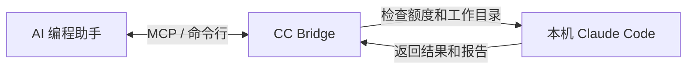

# CC Bridge

[English](README.md) | 简体中文

**把任务交给本机 Claude Code，让它在额度允许的情况下做事，并把进度和结果留在本地。**

CC Bridge 是 AI 编程助手和 Claude Code 之间的一座本地桥。你可以让 Codex 或其他 Agent
通过它提交任务、查询进度、读取报告。额度接近你设置的上限时，任务会先等一等，
到了服务返回的 reset 时间，再查一次额度，确认允许后继续。

**使用前必须有能调用的 Claude Code CLI 和 Python 3.10+。** 先运行 `claude --version`
确认命令可用。仅仅装了某个桌面应用，并不代表这个命令一定存在。Bridge 负责组织本地
CLI 的执行，不是直接调用 Claude 模型 API 的客户端。

**v1.1.2 · MIT 开源 · 本地优先 · MCP + 命令行 · Windows 离线测试**



## 它能帮你做什么？

- **把任务交出去，并随时回来查进度。** 任务有 ID，状态、结果和日志会保存到磁盘。
- **启动前先查额度。** 同时检查最新的 5 小时窗口和每周额度，避免不知道余量就开始工作。
- **给你留一点手动使用的余量。** 默认到 5H 的 90% 或 weekly 的 95% 就暂停新的自动执行；比例可以改。
- **等额度恢复后接着做。** 等待状态会保存下来，重启以后也能知道该继续哪个任务。
- **知道任务什么时候结束。** 完成事件能被其他本地 Agent 领取、处理和确认。
- **检查报告确实交付了。** 每轮执行只有一份规范报告，并核对任务 ID、轮次和文件哈希。
- **控制工作范围。** 同一运行目录只允许一个活跃任务；写任务需要先信任项目目录。

它适合通过 MCP 接进 AI Agent，也可以直接用命令行。任务说明仍要由上层 Agent 整理，
不会自动同步两个助手的全部聊天记录。

## 安装和连接

先安装、登录并配置好 [Claude Code](https://code.claude.com/docs/en/setup)，确认
`claude --version` 能运行。Bridge 会沿用你现有的模型服务和代理配置。
目前额度检查支持 Claude 的文件型订阅登录；只有系统钥匙串登录、或使用 API 服务商的
环境，可能会返回 `AUTH_STALE` 或 `UNKNOWN`，不能假定都能查到订阅余量。

在 PowerShell 中运行：

```powershell
git clone https://github.com/AlexLI1935/cc-bridge.git
cd cc-bridge
python -m venv .venv
.\.venv\Scripts\python.exe -m pip install -r requirements-mcp.txt
.\.venv\Scripts\python.exe cc_bridge.py config show
```

如果通过 MCP 使用，把下面的配置加到客户端，两个占位符都换成**绝对路径**。
Windows 的 JSON 路径可以使用 `/`。配置放在哪个文件里，以客户端说明为准；
[examples/mcp.json](examples/mcp.json) 也提供了模板。

```json
{
  "mcpServers": {
    "cc-bridge": {
      "command": "<虚拟环境中 Python 的绝对路径>",
      "args": ["<项目的绝对路径>/mcp_server.py"]
    }
  }
}
```

MCP 可以理解成 AI 工具之间的通用接口。手动运行 `python mcp_server.py` 时，
程序会通过标准输入输出等待客户端连接；终端暂时没输出是正常的。只用核心 CLI 时，
Python 标准库就够了。

## 第一次使用：先确认权限

额度检查需要读取本机 Claude 登录中的认证信息，所以默认没有授权。
Agent 必须先向用户说明并取得一次明确同意：

> 是否允许 CC Bridge 读取本机 Claude Code 的认证凭据，仅用于查询 Claude 订阅额度？

同意后，用 Bridge 所在的 Python 环境运行：

```powershell
python cc_bridge.py usage-authorize --yes
python cc_bridge.py usage-refresh
```

不带 `--yes` 时，交互式终端会询问确认。Agent 只能在用户同意后使用这个选项；
没有可以自行授权的 MCP 工具。需要撤销时运行 `python cc_bridge.py usage-revoke`。

保存下来的只是“已授权、授权时间、用途”这类记录，没有 token。认证信息只会从
Claude 的本地文件进入当前进程内存，再发送到固定的 Anthropic HTTPS 额度接口；
请求不跟随重定向，也不会把凭据复制到配置、缓存、日志、报告或 MCP 返回值里。

这个额度接口**不是承诺长期稳定的公开 API**。它依赖本地 Claude 的订阅登录行为，
以后可能变化。查不到时会明确返回未知或过期状态，不会编造可用额度。上次成功的数据
可以作为历史参考，但会标记为过期，并保留 `last_valid_at`，不会用它启动自动任务。

## 提交一个任务

通过 MCP 调用 `submit_cc_task`，提供任务目标、现有项目的绝对路径和任务说明。
它会启动后台执行，或在额度达到上限时返回 `WAITING_USAGE_RESET`。

```json
{
  "goal": "检查这个项目",
  "workdir": "<项目的绝对路径>",
  "prompt": "找出一个有明确依据的代码问题，说明触发条件和对应文件。不要修改文件。",
  "mode": "read_only"
}
```

保存返回的 `task_id`，之后用 `get_cc_task` 查询。设置 `full=true` 可以读取完整结果、
报告校验状态和日志路径，不需要再手动启动 runner。

命令行也可以这样用：

```powershell
$project = (Get-Location).Path
$created = python cc_bridge.py new --goal "检查这个项目" --workdir $project --prompt-file examples/review.md | ConvertFrom-Json
$taskId = $created.task_id
python cc_bridge.py submit $taskId
python cc_bridge.py status $taskId
python cc_bridge.py result $taskId
python cc_bridge.py list --limit 10
```

`new` 只保存任务，`submit` 才会后台启动。新任务也可以用 `run $taskId` 在前台执行。

需要改文件时，先明确授权项目根目录，再创建 `--mode write` 的任务，或在 MCP 中传入
`mode="write"`。下面也列出了续跑、取消和撤销目录授权的命令：

```powershell
python cc_bridge.py trust-workspace $project --yes
python cc_bridge.py resume $taskId --prompt "继续调查刚才的问题。"
python cc_bridge.py cancel $taskId
python cc_bridge.py revoke-workspace $project
```

目录授权覆盖解析后的根目录及其子目录。续跑保留原来的权限模式，使用保存的精确会话
UUID；从未启动就被额度拦住的任务，可以稍后首次启动。已经中断但没有可用会话 ID 的
任务不会被悄悄重放。取消也能终止等待中的任务，但不会撤销已经产生的文件修改。

## 额度策略：默认给手工操作留一点余量

首次启动会自动生成 **`CC_BRIDGE_HOME/config.json`**，运行时以这份配置为准，
不依赖仓库里的文件。[config.example.json](config.example.json) 是完整的配置示例。

| 配置 | 默认值 | 意思 |
| --- | --- | --- |
| `usage.five_hour.max_utilization_pct` | `90` | 5H 达到 90% 时不再启动自动工作，目标是留约 10% 给手工操作 |
| `usage.weekly.max_utilization_pct` | `95` | weekly 达到 95% 时暂停，留约 5% 应急余量 |
| 每个窗口的 `auto_wait_for_reset` | `true` | 保存等待状态，安排下一次检查 |
| 每个窗口的 `auto_resume_after_reset` | `true` | 所有检查重新通过后，继续原本要做的任务 |
| `usage.refresh_interval_minutes` | `5` | 额度查询的最短间隔，也是任务运行时的刷新周期；不能低于 5 分钟 |
| `usage.fresh_seconds` | `300` | 缓存未满 300 秒时可用；不能设得比 300 秒更长 |
| `usage.reset_grace_seconds` | `60` | 到实际 reset 时刻后再等一分钟，重新确认额度 |
| `timezone.mode` | `system` | 每次启动、刷新时重新读取操作系统时区 |
| `reset_scheduler.backend` | `system` | Windows 使用任务计划程序；无法注册时保留等待记录，改由调用方检查 |

两个窗口都要**严格低于**各自上限，才允许启动。若两个都阻塞，就取服务返回的
较晚 reset 时刻，再加宽限时间。绝不会用“现在往后五小时”猜恢复时间。

**查额度至少隔 5 分钟，默认也是 5 分钟，不能连续查。** 提交、执行和续跑短任务时，
会共用仍然有效的额度缓存，避免一连串请求触发限流。缓存未满 5 分钟时直接用缓存；
满 5 分钟后，等到允许查询时刷新，再读取刚保存的新结果。
跨过 reset 时刻后，旧数据也不能用来证明额度已经恢复。没有有效数据，就等下次
允许查询且查询成功后再启动。查询失败同样计入间隔；服务端要求等更久时，以它返回的
`Retry-After` 为准。查询冷却记录重启后仍然保留，同一账号应共用同一个运行目录。
平时查看任务进度不会查额度，`get_cc_usage` 也只读缓存。
升级时会把旧版默认的“6 分钟查询、420 秒缓存”改成“5 分钟查询、300 秒缓存”，
已有的额度授权、目录授权和 90%/95% 上限不会丢失。

到了时间仍会重新查两个窗口。服务还显示超限，就保存新的结果继续等待；认证失败、
未知或过期数据都不能直接启动。执行轮次、等待周期、派发事务和内核锁共同防止重复续跑。
运行中的任务在周期检查发现超限时，也会停下来等后续继续。

这是一套资源治理策略，不是实时计费硬上限。服务数据可能延迟，两次检查之间也可能
产生用量，所以不能保证每次都刚好留下精确的 10% 或 5%。

Windows 的待检查任务会注册到系统任务计划程序，错过时刻后可在系统恢复时补查。
每个运行目录只用一个计划任务。若注册失败，返回 `caller_polling`；继续查询
`get_cc_pending`，或运行 `python cc_bridge.py scheduler-tick` 即可处理到期等待。
Linux/macOS 当前也采用这种持久记录加调用方检查的方式；没有调用方或外部调度时，
它们不会自行唤醒。想只手动续跑，可关闭**两个窗口**的自动续跑选项。

```powershell
python cc_bridge.py config show
python cc_bridge.py config validate
python cc_bridge.py config set usage.five_hour.max_utilization_pct 85
python cc_bridge.py config set usage.weekly.auto_resume_after_reset false
```

也可以直接编辑 `config.json`，但修改后要校验。非法配置会阻止执行；阈值只能是
0..100 的有限数字，时区模式支持 `system` 或 `explicit`。`usage.enabled=false` 会同时停用
凭据读取和自动任务执行，不是绕过额度检查的开关。授权和目录信任使用专门命令管理。

认证过期时，程序先尝试不生成模型内容的 `claude auth status`，再重新读取登录文件。
这条命令不保证一定刷新成功；默认失败就返回 `AUTH_STALE`。旧版的小型 CLI 探测兜底
保留在 `usage.allow_cli_refresh_probe` 后面，默认关闭，单独开启后可能消耗模型额度。
Bridge 不会自己重新实现 OAuth 登录流程。

## 时间、报告和完成通知

时间依据只有操作系统时钟、系统时区规则和接口返回的绝对 reset 时间。模型说的
“现在几点”、使用什么语言、服务器 IP 在哪，都不参与计算。内部以 UTC/epoch 调度，
本地时间只用于显示和系统调度表示。换算使用 **reset 那一刻**的时区规则，因此能处理
夏令时变化。系统时区改变后，会更新配置、等待记录的本地显示及必要的调度信息。
HTTPS 响应 Date 与系统时钟差异严重时，返回 `CLOCK_SKEW` 并阻止创建调度。

任务结束后，要看最终状态和 `report_validated`。每轮有一份规范 `report.md`，校验记录
把文件哈希、任务 ID 和轮次对应起来。这能确认报告存在且内容匹配，但不能证明模型的
代码结论一定正确；仍应检查文件改动、运行适当测试。

完成事件保存在 `runtime/pending`。先用 `get_cc_pending` 查看，再用 `claim_cc_pending`
领取一个明确的 `event_id`，处理后调用 `done_cc_pending`。`first_claim` 只会成功一次；
领取后客户端崩溃的情况，需要调用方有意识地接着处理。

事件包括完成、失败、需要输入，以及 `TASK_WAITING_USAGE_RESET`、`USAGE_AVAILABLE`、
`TASK_RESUMED`、`TASK_CANCELLED`，可以看出任务是怎么等待、恢复和结束的。

需要本地通知时，可把 `CC_BRIDGE_WAKE_COMMAND` 设置为 JSON 参数数组，例如
`["my-local-notifier","--event"]`。Bridge 会追加事件 ID 和任务 ID，不经过 shell，
也不保留命令输出。这个 hook 只做尽力通知；即使通知失败，持久事件仍然保留。
项目不内置任何聊天服务绑定。

## 接口和数据放在哪里？

原有五个 MCP 工具名称和参数保留：`submit_cc_task`、`get_cc_task`、`resume_cc_task`、
`cancel_cc_task`、`list_cc_tasks`。新增 `get_cc_usage`、`refresh_cc_usage`、
`get_cc_pending`、`claim_cc_pending`、`done_cc_pending`。其中 `get_cc_usage` 只看缓存。

新增 CLI 包括 `usage`、`usage-refresh`、`usage-authorize`、`usage-revoke`、
`config show|validate|set`、`environment`、目录信任/撤销、事件领取/确认、
`schedule-reset-reminder`、`usage-reset-notify` 和 `scheduler-tick`。完整选项见 `--help`。

查询返回 `success=true` 只表示“查询成功”，任务是否完成还要看 `status`。
CLI 退出码：0 表示操作已接受，1 表示前台任务没有成功完成，2 表示操作错误。

| 环境变量 | 用途 |
| --- | --- |
| `CC_BRIDGE_HOME` | Windows 默认 `%LOCALAPPDATA%/cc-bridge`，其他环境默认 `~/.cc-bridge` |
| `CC_BRIDGE_CLAUDE_PATH` | PATH 中找不到 `claude` 时使用的可执行文件路径 |
| `CLAUDE_CONFIG_DIR` | Claude 已有的可选配置目录，用于定位文件型认证信息 |

运行目录内，`tasks/` 放任务，`results/` 放结果和逐轮日志，`runtime/` 放缓存、事件和锁。
请放在私有本地磁盘，别提交到 Git。程序不会自动读取 `.env`。

## 权限与目前的限制

- 默认 `read_only` 只提供 Read/Glob/Grep，使用 plan 模式，不能运行测试命令。
- `write` 使用 dontAsk，需要信任工作目录，仍受 Claude 权限规则约束，不提供权限绕过。
  子会话的 MCP、hooks 和斜杠命令会关闭。这些控制不等于操作系统沙箱。
- 额度查询目前依赖文件型订阅认证；钥匙串专用登录或其他服务商可能不支持。
  未知额度会阻止自动执行，而不是假装充足。
- Windows 子进程、MCP、时区和调度 XML 使用模拟程序或 mock 验证。离线测试没有访问真实
  账户、调用真实模型或注册实际系统唤醒任务。Linux/macOS 尚未正式验证。
- 强制结束 runner 可能留下子进程。`cleanup_required=true` 会阻止继续执行；
  手动停掉进程树并确认结束后，才能清除最新结果里的标记。
- MCP 是面向可信客户端的本地 stdio 服务，没有网络认证。不要直接暴露到网络；
  提示词、代码片段、结果和日志也可能包含敏感数据，请妥善保管。

## 开发和 Agent 部署

```powershell
.\.venv\Scripts\python.exe -m pip install -r requirements-dev.txt
.\.venv\Scripts\python.exe -m pytest -q
```

测试使用模拟 Claude 程序和额度响应，不访问真实账户，也不消耗真实模型额度。
[SKILL.md](SKILL.md) 是 Agent 的部署与操作合同；[能力对比](CAPABILITIES.md) 记录了
本次保留和恢复的能力。

v1.0 的 MCP 配置和五个核心工具签名可继续沿用，**执行条件更严格了**：需要额度授权、
最新的可用额度，写任务还要信任工作目录。旧任务仍可查询，不会自动升级现有生产安装。

## 协议和作者

采用 [MIT License](LICENSE)，版权归 2026 Alex Li 所有。

由 [Alex Li](https://github.com/AlexLI1935) 创建和维护。

## 后台写代码：批准目录后，可以正常跑开发命令

write 模式使用 `dontAsk`，预先允许 Read、Glob、Grep、Edit、Write、NotebookEdit、Bash，
不传 `--tools`。批准 workspace 后，CC 可以像普通编程 Agent 一样读写、运行 Python、
测试和本地 git 命令；其他需要审批的操作直接拒绝，不会等人点击。部署、远程推送和
系统变更仍不属于默认任务合同。没有自动 bypass；Bash 的工具授权也不是操作系统沙箱，
不能保证命令在物理上无法访问目录外。请只批准可信项目和你打算执行的任务。

read_only 仍只提供 Read/Glob/Grep，不能执行 Bash 或修改文件。已有的系统/用户 deny
规则继续有效。`environment` 会显示实际 CLI 版本。隔离验证过 Windows CLI 2.1.286；
本机对照中 `--tools` 没有导致 Bash 消失，因此不把这件事宣称为该版本的普遍缺陷。
write 仍移除该参数以减少兼容风险，不做脆弱的精确版本封锁。

## 时间怎么理解

内部真值使用 UTC/epoch：reset、缓存年龄、冷却和一次性唤醒都按绝对时间处理。
“五小时后”就是 `now_epoch + 18000`，不是先变成本地墙钟再调度。
运行中任务超时采用单调时钟，避免调整系统墙钟延长执行时间；额度恢复仍以接口实际 reset 为准。

显示时区优先级是：显式配置 > 有效 OS 时区 identity > UTC 回退。Windows 默认使用系统
时区名称和系统规则；覆盖时使用 IANA identity 与 ZoneInfo/tzdata 规则。
先用 `config set timezone.name '"Europe/Berlin"'` 设置名称，再将 `timezone.mode`
设为 `"explicit"`；设回 `"system"` 就恢复操作系统默认值。迁移会补齐新字段，保留已有授权。
换算未来时刻使用那个时刻的 DST 规则，不使用当前固定 offset。

启动诊断包含系统 UTC、OS 时区和本地时间；额度刷新取得可信 HTTPS Date 后，才有外部
UTC 和偏差验证。没有外部参考时显示 UNVERIFIED。严重偏差报告 CLOCK_SKEW 并阻止启动
和调度；可检测的墙钟/时区/UTC 不自洽报告 TIMEZONE_OR_CLOCK_MISCONFIGURED。
如果错误时区配上被人为调整的时钟，系统内部可能仍自洽：此时只能发现外部 UTC 偏差，
无法推断用户本来想用哪个时区。请修正 OS 时钟/时区或显式显示配置，Bridge 不猜地理位置，
不用 IP 定位，也不替用户偷偷改系统设置。

“每天当地 09:00”应保存时区、当地时间和周期规则，每次重新按 DST 规则计算下一次 UTC。
`cc_time.next_local_occurrence` 提供这种换算：跳过不存在的当地时刻，重复时刻只取第一次。
这是转换函数，不是新增周期任务服务；宿主负责保存规则并调度。绝对/相对一次性任务的
触发瞬间不受显示时区和 DST 改变影响。
